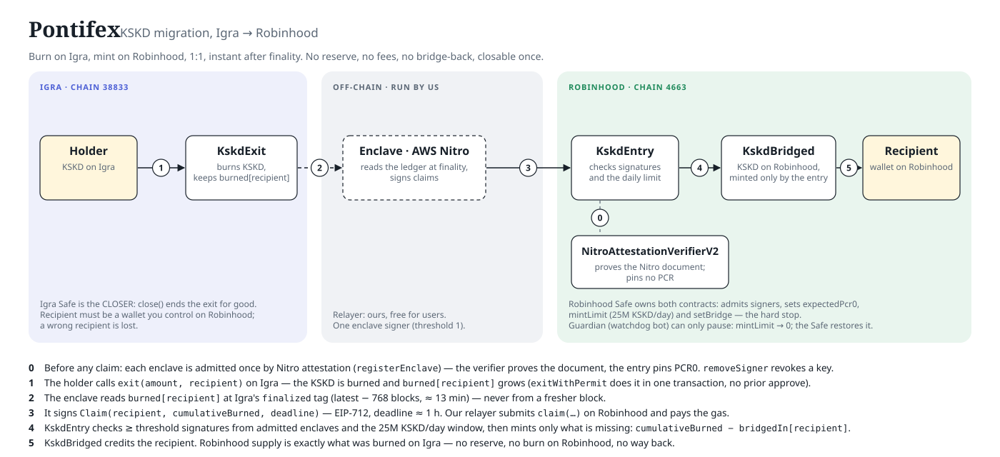

# Pontifex — architecture overview

Pontifex moves KSKD from Igra to Robinhood, once. A holder burns KSKD on Igra; an AWS Nitro enclave watches the burn
ledger and signs a claim; our relayer submits the claim on Robinhood and the recipient receives the same amount of KSKD
there. 1:1, no reserve, no fee, no way back. When the migration is over, the exit is closed for good and the Robinhood
supply is frozen.

This page is the tour. The full spec is `DESIGN.md`, the deploy/ops runbook is `../script/README.md`.

## Three contracts

| Contract | Chain | Job | Who controls it |
|---|---|---|---|
| `KskdExit` | Igra | Burns KSKD and keeps `burned[recipient]`, a cumulative total per recipient | No owner, no rescue path. The Igra Safe is `CLOSER`: it can call `close()` once and set the per-call burn floor `minBurn` |
| `KskdEntry` | Robinhood | Admits enclave signers by attestation, verifies claims, enforces the daily limit, tells the token to mint | Robinhood Safe (owner). A guardian bot can only pause |
| `KskdBridged` | Robinhood | The KSKD token on Robinhood (`Kaskad` / `KSKD`, 18 decimals, ERC20 + Permit). Mints only on the entry's word and keeps `bridgedIn[recipient]` | Robinhood Safe (owner). Its only lever is `setBridge` |

Plus `NitroAttestationVerifierV2` on Robinhood, deployed separately: it proves that an attestation document is genuine
AWS Nitro output and returns the document's PCR0 and signer key. It pins no PCR; the entry's `expectedPcr0` is the only
image pin.

## One migration, step by step

0. **Admission, once per enclave.** The Safe calls `registerEnclave(attestationDoc)`. The verifier checks the Nitro
   certificate chain and the document signature; the entry checks PCR0 against `expectedPcr0` and admits the signer
   address found in the document. `removeSigner` revokes it.
1. **Exit.** The holder calls `exit(amount, recipient)` on Igra with `amount ≥ minBurn`. KSKD is pulled from the
   holder, burned, and `burned[recipient]` grows by `amount`. `exitWithPermit` does the same in one transaction,
   without a prior `approve` (the holder signs the permit, so this call cannot be relayed by someone else).
2. **Read at finality.** The enclave reads `burned[recipient]` at Igra's `finalized` tag — latest − 768 blocks,
   ≈ 13 min at 1.05 s blocks. Never from a fresher block: a reorg must not be able to un-burn what was already claimed.
3. **Sign and relay.** The enclave signs `Claim(recipient, cumulativeBurned, deadline)` — EIP-712, domain
   `Pontifex` / `1`, deadline ≈ 1 h. Our relayer submits `claim(recipient, cumulativeBurned, deadline, signatures)`
   on Robinhood and pays the gas. `claim` is permissionless: anyone holding the signatures can submit them.
4. **Verify and mint.** The entry rejects expired claims, requires at least `threshold` signatures from admitted
   signers (strictly ascending, no duplicates), checks the daily window, and asks the token to mint only what is
   missing: `cumulativeBurned − bridgedIn[recipient]`.
5. **Credit.** `KskdBridged` mints to the recipient and records the new `bridgedIn[recipient]`. Robinhood supply is
   exactly what was burned on Igra — no reserve, no burn on Robinhood, no way back.

## The one idea to understand: cumulative totals, not amounts

The enclave never signs "mint 100 to Alice". It signs "Alice has burned 1,250 in total so far". The entry compares
that with what the token has already minted for Alice and mints the difference. Everything else falls out of this:

- A signature can be replayed any number of times — a replay mints nothing new.
- No nonces, no transfer ids, no "processed" set. The only state is two monotonic counters per recipient, one on
  each chain.
- A claim that hits the daily limit mints what fits; the same signatures finish the job in the next window.
- Several exits to the same recipient collapse into one claim.
- Replacing the entry contract (a verifier change) migrates no state and cannot double-mint, because the counter
  lives in the token.

## Who can do what

- **Mint.** Only `KskdBridged.bridgeMint`, only from `bridge` (= `KskdEntry`), only after `threshold` valid enclave
  signatures. Enclave keys exist only inside a Nitro enclave and reach the chain only through attestation.
- **Robinhood Safe** (owner of entry and token): `registerEnclave`, `removeSigner`, `setThreshold`,
  `setExpectedPcr0`, `setMintLimit`, `setGuardian`; on the token `setBridge`. It cannot mint directly and cannot
  renounce the entry (`RenounceDisabled`).
- **Guardian** (watchdog bot, hot key): `pause()` only, which sets `mintLimit = 0`. Restoring is the Safe's job.
- **Igra Safe** (`CLOSER`): `close()` once and `setMinBurn`. Neither touches the `burned` ledger.
- **Relayer:** no privilege at all. It only pays gas.
- **Blast radius.** A compromised enclave key mints at most `mintLimit` per day (`mintLimit` = 25M KSKD) until `pause`
  or `removeSigner`; `MAX_SUPPLY` = 1,000,000,000 KSKD is the hard ceiling, matching the Igra total supply.

## Limits and kill switches

- `mintLimit` = 25M KSKD per tumbling 1-day window. The window starts with the first claim after the previous one
  expired, so up to 2 × `mintLimit` can cross a boundary.
- `pause()` — guardian only, sets `mintLimit = 0`. The Safe stops claims with `setMintLimit(0)` and restores them with
  `setMintLimit(x)`. Both stops emit `MintLimitSet(0)`; there is no separate `Paused()` event.
- `removeSigner(signer)` — revokes one enclave key.
- `setBridge(address(0))` on the token — hard stop for all minting, whatever the entry says.
- `setMinBurn(type(uint256).max)` on the exit — stops new burns on Igra until `CLOSER` lowers it again.
- `close()` on the exit — no more burns on Igra, permanently.
- A leaked signature dies at its `deadline` (≈ 1 h): pause for that long, then `removeSigner`.

## Irreversible by design — what a user must know

- A wrong `recipient` is final. The KSKD is minted to that address on Robinhood; no admin can redirect it.
- KSKD sent directly to `KskdExit` (a plain transfer instead of `exit`) is lost.
- The recipient must be an address the user controls on Robinhood. A contract address from Igra usually does not
  exist there.
- A claim waits for Igra finality (≈ 13 min) and, when the day's limit is used up, for the next window.

## Deployed parameters

Read on Igra block 19,307,398 and Robinhood block 89,211,154.

| Parameter | Value |
|---|---|
| `minBurn` | 1,000 KSKD per `exit` call |
| `threshold` / registered signers | 1 / 1 |
| `mintLimit` / `WINDOW` | 25,000,000 KSKD / 1 day |
| `expectedPcr0` | `0x8761b33a338db4fab12c9201eef87e1c582310d59645848c2574061d1e070d71` (first 32 of the 48 PCR0 bytes) |
| Verifier | `NitroAttestationVerifierV2` `0x52A22A678Af63d74BBfCB4c8fA90299db2760ACD`, pins no PCR |
| Enclave read depth | Igra `finalized` = latest − 768 blocks (≈ 13 min) |
| Signature `deadline` | now + 1 h (enclave policy) |
| Relayer | ours, free for users; the burn floor is on-chain (`minBurn`) |
| `CLOSER` | Igra Safe `0x5B95Ea5D5B63998467eE92B0b175ACE49ccC1943` (Safe 1.5.0, 3 of 5) |
| Owner of entry and token | Robinhood Safe `0x313807B857222278FbddF36541DE2Af5a50BdCB5` (Safe 1.4.1, 3 of 5) |
| Guardian | `0x217714D086f7254940a46c0C6Abc1e7bF270235e`, the watchdog bot's key (EOA) |
| `MAX_SUPPLY` | 1,000,000,000 KSKD |

## Lifecycle

1. `DeployExit` on Igra (also checks the live KSKD permit domain), with `minBurn = type(uint256).max` so no burn is
   accepted before the public opening.
2. `DeployRobinhood`: `KskdBridged` and `KskdEntry` against the deployed V2 verifier; owner = Safe, `bridge` = entry.
3. `SetGuardian`, then `RegisterEnclave`, from the Safe: the script refuses to arm the live bridge unguarded.
4. Treasury tranche in its own window under a temporary limit raise, then `setMintLimit(25M)`.
5. Public opening: `setMinBurn` lowers the floor to 1,000 KSKD.
6. Wind-down: `close()` → grace period → `setMintLimit(0)` → `setBridge(0)` → token `renounceOwnership()`.
   Supply frozen forever.

## Numbers

- Gas: `exit` 81,474 first / 31,674 repeat; `exitWithPermit` 130,014 / 60,214; `claim` 14.8k–124k against the
  Robinhood 32M per-transaction cap. At 0.055 gwei a claim costs ≈ $0.02.
- Runtime bytecode (`forge build --sizes`, equal to the deployed runtime): Exit 1,975 B, Bridged 4,813 B,
  Entry 5,582 B.
- Tests: 295 unit (invariants, reentrancy, gas ceilings) + 38 fork: 22 two-fork Igra mainnet ↔ Robinhood testnet
  end-to-end runs, 8 against the Igra price-oracle verifier (V1, pins PCR1/PCR2) with captured attestation documents,
  and 8 script runs against live Safes and verifiers (5 on Robinhood testnet, 3 on Igra). No test runs the deployed
  V2 verifier.
- Toolchain: forge 1.4.3, solc 0.8.30, OpenZeppelin 5.6.1. Apache-2.0.
